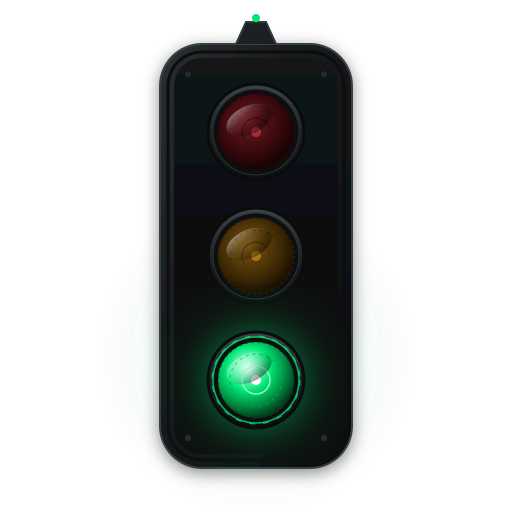

<p align="center">
  
</p>

<h1 align="center">
  
</h1>

<p align="center">
  <strong>Real-time desktop status light &amp; audio-visual signals for AI coding agents.</strong><br/>
  <sub>Ambient hardware-grade status HUD engineered for Google Antigravity, Claude Code, and autonomous developer workflows. 100% local, zero telemetry, instant response.</sub>
</p>

<p align="center">
  <a href="https://www.npmjs.com/package/@nomanrafique/agentpulse">
    
  </a>
  
  
  
  
  <a href="https://github.com/NomanRafique01/AgentPulse/blob/main/LICENSE">
    
  </a>
  
</p>

---

## Table of Contents

- [Why AgentPulse](#why-agentpulse)
- [Antigravity First-Class Integration](#-antigravity-first-class-integration)
- [Quick Start](#-quick-start)
- [Signal States &amp; Lamp Matrix](#-signal-states--lamp-matrix)
- [Audio Feedback Engine](#-audio-feedback-engine)
- [CLI Command Reference](#-cli-command-reference)
- [Architecture &amp; How It Works](#-architecture--how-it-works)
- [Configuration (`.agents/hooks.json`)](#-configuration-agentshooksjson)
- [Publishing &amp; Distribution](#-publishing--distribution)
- [Roadmap](#-roadmap)
- [FAQ](#-faq)
- [Feedback &amp; Community](#-feedback--community)
- [License](#-license)

---

## Why AgentPulse

When AI coding agents write code, execute shell commands, or plan complex refactors, developers are forced to constantly alt-tab, stare at terminal scrollback, or wonder if the agent is still running or blocked waiting for a prompt response.

AgentPulse bridges the gap between terminal agents and physical reality by floating an ambient industrial 3-lens signal lamp directly on your workspace.

| Capability | Terminal-Only Agents | Web Dashboards | **AgentPulse** |
|---|:---:|:---:|:---:|
| **Ambient Awareness** | ❌ Stare at CLI logs | ❌ Buried in browser tab | **🟢 Floating desktop signal lamp** |
| **User Input Alerts** | ❌ Silent block | ⚠️ Browser banner | **🟡 Warm amber pulse + synthesized chime** |
| **File Write Visibility** | ❌ Hidden in stream | ⚠️ Manual refresh | **🟢 Dynamic rapid emerald pulse** |
| **Local Privacy** | 🟢 Local | ❌ Cloud relay required | **🟢 100% Localhost IPC (`127.0.0.1`)** |
| **System Overhead** | 🟢 Low | ❌ Heavy web app | **🟢 ~35 kB CLI footprint, micro daemon** |
| **Setup Friction** | ❌ None | ❌ Account &amp; API keys | **🟢 Single command: `agentpulse init`** |

---

## ⚡ Antigravity First-Class Integration

> [!IMPORTANT]
> **Native Google Antigravity Support**: AgentPulse is designed out of the box to integrate seamlessly with Google Antigravity workspaces and standard agent hook lifecycles.

When running in an **Antigravity** project, AgentPulse hooks into the agent event bus:
1. **Model Generation &amp; Planning**: Triggers an emerald glow so you know Antigravity is formulating thoughts.
2. **Tool Invocations &amp; File Edits**: Intercepts `write_file`, `edit_file`, and patch operations to trigger rapid tactile write pulses.
3. **Terminal Execution**: Reflects active PowerShell / Bash commands via steady amber indicator.
4. **Interactive Questions (`ask_question`)**: Immediately shifts to blinking amber with gentle acoustic notification, alerting you that Antigravity needs your input.
5. **Session Completion**: Transitions to a clean fade when tasks finish and the agent goes idle.

---

## 🚀 Quick Start

### 1. Global Installation (npm)
Install AgentPulse globally via npm:

```bash
npm install -g @nomanrafique/agentpulse
```

### 2. Or Run Instantly via npx
No permanent installation needed:

```bash
npx @nomanrafique/agentpulse init
```

### 3. Connect to Any Project
Navigate to any workspace (such as an Antigravity repo or code directory) and run:

```bash
agentpulse init
```

This command will:
- Generate a unique, isolated session route for the current project.
- Automatically link or generate `.agents/hooks.json`.
- Summon the floating desktop signal light immediately.

---

## 🚦 Signal States & Lamp Matrix

AgentPulse models a precision industrial stacklight featuring three high-fidelity optical lenses: **Red**, **Yellow / Amber**, and **Green**.

| State | Lamp Lens | Visual Behavior | Trigger Event / Antigravity Hook |
|---|:---:|---|---|
| **Thinking / Planning** | 🟢 Green | Steady luminous glow | Agent prompt processing, reasoning, LLM output generation |
| **Writing / File Edits** | 🟢 Green | Fast energetic pulse | `write_file`, `edit_file`, applying patches or diffs |
| **Running Terminal** | 🟡 Yellow | Steady warm glow | `run_command`, CLI process, npm builds, tests running |
| **Waiting on User** | 🟡 Yellow | Periodic breathing blink | `ask_question`, permission dialog, blocked on user input |
| **Error / Tool Failure** | 🔴 Red | High-alert rapid blink | Command failure, test rejection, unhandled exception |
| **Finished / Idle** | ⚪ Off | Smooth graceful fade | Task completed, context reset, subagent idle |

---

## 🔊 Audio Feedback Engine

AgentPulse features an integrated acoustic engine engineered for calm situational awareness:
- **Zero MP3 / WAV bloat**: Sounds are synthesized mathematically in real-time using the **Web Audio API**.
- **Harmonic Chimes**: Pleasant, non-jarring sine/triangle frequencies signal transitions (e.g. agent prompt required, build failure, task done).
- **Subtle Volume Calibration**: Designed to blend into background focus playlists without causing audio fatigue.

---

## 💻 CLI Command Reference

AgentPulse comes with an expressive CLI available via both `agentpulse` and `agentlight`:

```bash
# Initialize and connect the current workspace
agentpulse init

# Summon the desktop signal window manually
agentpulse start

# Deactivate signals and cleanly decouple workspace hooks
agentpulse off

# Send a manual status signal test
agentpulse send --state thinking
agentpulse send --state writing
agentpulse send --state ask
agentpulse send --state error
agentpulse send --state idle

# Complete removal and clean up
agentpulse uninstall
```

---

## 🏗 Architecture & How It Works

```
┌────────────────────────────────────────────────────────┐
│     Google Antigravity / Coding Agent Workflow         │
│     (Tool Calls, Prompts, Terminal Commands)           │
└───────────────────────────┬────────────────────────────┘
                            │ Stdin Hook Stream
                            ▼
┌────────────────────────────────────────────────────────┐
│     AgentPulse CLI Bridge (`agentpulse.js`)            │
│     - Ingests hook events in < 2ms                     │
│     - Resolves local daemon port (~/.agentpulse)       │
└───────────────────────────┬────────────────────────────┘
                            │ Local HTTP POST (127.0.0.1)
                            ▼
┌────────────────────────────────────────────────────────┐
│     AgentPulse Desktop Shell (`main.js`)               │
│     - Frameless, transparent, always-on-top window     │
│     - System tray companion & multi-project router     │
└───────────────────────────┬────────────────────────────┘
                            │ IPC Frame Dispatch
                            ▼
┌────────────────────────────────────────────────────────┐
│     Renderer & Synthesizer (`renderer.js`, `sound.js`) │
│     - GSAP 60fps lens illumination & bloom physics     │
│     - Web Audio API harmonic sound synthesizers        │
└────────────────────────────────────────────────────────┘
```

1. **Localhost Daemon**: A background service listens on a dynamically assigned local port saved to `~/.agentpulse/port.json`.
2. **Micro Stdin Pipe**: Coding agent hooks pipe JSON payloads directly into `agentpulse.js` with sub-millisecond execution and a 180ms safety timeout.
3. **Hardware Acceleration**: The floating widget uses GPU compositing for sub-pixel smooth animations with near-zero CPU footprint.

---

## ⚙️ Configuration (`.agents/hooks.json`)

AgentPulse automatically provisions your `.agents/hooks.json` file. Here is what an active hook configuration looks like:

```json
{
  "version": 1,
  "hooks": {
    "on_agent_start": "agentpulse signal --state thinking",
    "on_tool_start": "agentpulse hook",
    "on_tool_end": "agentpulse hook --finish",
    "on_user_prompt": "agentpulse signal --state ask",
    "on_agent_end": "agentpulse signal --state idle"
  }
}
```

---

## 📦 Publishing & Distribution

To publish updates to the public npm registry:

```bash
# 1. Authenticate with npm
npm login

# 2. Build distributions (if applicable)
npm run build:dist

# 3. Publish public scoped package
npm publish --access public
```

---

## 🗺 Roadmap

- [x] Multi-lens physical industrial signal lamp UI
- [x] Antigravity `.agents/hooks.json` automatic linking
- [x] Zero-dependency Web Audio acoustic engine
- [x] Port discovery daemon with legacy `.agentlight` compatibility
- [ ] Multi-agent concurrent status monitor (track 3+ agents simultaneously)
- [ ] Physical USB status light hardware support (BlinkStick / WebSerial)
- [ ] Sound profile customizer (Chime, Retro 8-bit, Mechanical Click)
- [ ] Compact mini-dock mode for ultra-narrow status bars

---

## ❓ FAQ

<details>
<summary><b>Does AgentPulse send any data to external servers?</b></summary>
<b>No.</b> AgentPulse operates 100% offline. All inter-process communication occurs strictly over <code>127.0.0.1</code> (localhost) between the CLI and the desktop overlay. No analytics, tracking, or cloud servers are ever contacted.
</details>

<details>
<summary><b>Can I use AgentPulse with tools other than Antigravity?</b></summary>
<b>Yes.</b> While optimized for Antigravity, AgentPulse works with Claude Code, Cursor background tasks, custom Python LLM pipelines, or any shell script that can execute <code>agentpulse signal --state &lt;name&gt;</code>.
</details>

<details>
<summary><b>How do I hide or move the floating signal?</b></summary>
You can drag the signal lamp anywhere on your screen. It automatically remembers its position across restarts. You can also hide it into the system tray or toggle it with <code>agentpulse off</code>.
</details>

<details>
<summary><b>Is it heavy on system memory?</b></summary>
<b>No.</b> The background process uses minimal RAM and stays dormant when the agent is idle. The package itself is only ~35 kB.
</details>

---

## 💬 Feedback & Community

Encountered an issue or have a feature idea for AgentPulse?
- Open an issue on [GitHub Issues](https://github.com/NomanRafique01/AgentPulse/issues).
- Submit a Pull Request to contribute improvements.

---

## 📄 License

AgentPulse is released under the **[MIT License](LICENSE)** — free to use in personal, open-source, and commercial workflows.

<p align="center">
  <sub>Crafted with precision by <a href="https://github.com/NomanRafique01">Noman Rafique</a></sub>
</p>
